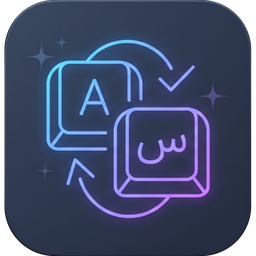

<div align="center">



# TypeFlow

**Smart language switcher for Windows**

Typed a word with the wrong keyboard layout? TypeFlow notices and fixes it with one key.<br>
English ⇄ Persian (فارسی).

[](../../releases/latest/download/TypeFlow-Setup.exe)

[Portable `TypeFlow.exe`](../../releases/latest/download/TypeFlow.exe) · [All releases](../../releases) · [How to use](#how-to-use) · [Build from source](#build-from-source) · [Privacy](#privacy)


</div>

---

## What it does

You meant to write **سلام** but the keyboard was on English, so you got `sghl`. TypeFlow watches for
this, shows a small hint with the word you meant, and lets you convert it **and** switch the
layout with a single <kbd>Tab</kbd>.

| You type | Layout was | TypeFlow suggests |
|---|---|---|
| `sghl` | English | **سلام** |
| `ldo,hl` | English | **میخوام** |
| `sghl o,fd?` | English | **سلام خوبی؟** |
| `اثممخ` | Persian | **hello** |

Real words in the layout you're using are left alone.

### Highlights

- ⚡ **Instant**: checks after every Space, or after a short pause in search boxes.
- 🎯 **Accurate**: uses word-frequency lists for both languages and reads whole phrases, not just single words.
- ⌨️ **One key to fix**: <kbd>Tab</kbd> converts the text and switches the layout for you.
- 🤖 **Optional auto-fix**: converts on its own when it's sure.
- 🪟 **Looks like Windows**: the hint is a small acrylic glass pill that follows your light/dark mode, accent color and transparency settings.
- 📍 **Stays out of the way**: the hint appears next to the text cursor without covering what you're typing.
- 📖 **Custom words**: add your own words per language, or let TypeFlow learn the ones you keep rejecting.
- 🔒 **Private**: no network code. Only your settings and your custom words are saved to disk.
- 📦 **Nothing else to install**: one installer (or one portable `.exe`) with everything built in.

> [!NOTE]
> TypeFlow is in early development. It runs from the system tray.

## Install

1. **[Download `TypeFlow-Setup.exe`](../../releases/latest/download/TypeFlow-Setup.exe)** from the latest release and run it.
2. Click **Yes**. It installs for your user only, so no admin rights are needed. If the English or
   Persian keyboard is missing, it offers to add it.
3. TypeFlow starts right away. Its **A ⇄ س** icon appears next to the clock (at first it may be
   under the **^** arrow; drag it onto the taskbar to keep it visible).

TypeFlow starts with Windows by default; you can turn that off from the tray menu. To remove it, use
*Settings → Apps → Installed apps → TypeFlow → Uninstall* (your settings are kept). Running a newer
installer updates TypeFlow in place.

> [!TIP]
> Windows SmartScreen may warn you because the app isn't code-signed yet. Click
> **More info → Run anyway**.

<details>
<summary><b>Portable exe and scripted installs</b></summary>

<br>

**Portable:** [`TypeFlow.exe`](../../releases/latest/download/TypeFlow.exe) runs without
installing. Put it in a folder you'll keep first: Start with Windows remembers where the exe is.
Both the **English** and **Persian** keyboards must be installed in Windows
(*Settings → Time & language → Language & region*).

**Installer details:** the app goes to `%LOCALAPPDATA%\Programs\TypeFlow\` with a Start menu
shortcut and an entry in *Installed apps*. `TypeFlow-Setup.exe /S` installs without questions (and
leaves the keyboards alone); `%LOCALAPPDATA%\Programs\TypeFlow\uninstall.exe /uninstall /S`
removes it.

</details>

## How to use

Just type anywhere. When the last few words look like they were typed in the wrong layout, a hint
appears near the text cursor with a short sound. If you keep typing in the wrong layout, the hint
grows to cover the whole phrase.

### Keyboard and mouse

| Action | What it does |
|---|---|
| <kbd>Tab</kbd> (only while the hint is showing) | Convert the text and switch the keyboard layout |
| **Click** the hint | Same as <kbd>Tab</kbd> |
| <kbd>Esc</kbd>, or just ignore it | Dismiss (the hint disappears after 5 seconds) |
| <kbd>Pause</kbd>, or tap <kbd>Right Ctrl</kbd> on its own | Accept the hint; with no hint, convert the last word |

### Auto-correct

Turn it on for English, فارسی, or both in the TypeFlow window. After you finish a misspelled word
with <kbd>Space</kbd>, a list of up to 5 corrections appears near the text cursor, most likely first,
each with its confidence, and a sound plays that is different from the wrong-layout sound. Nothing
changes until you choose one.

| Action | What it does |
|---|---|
| <kbd>Tab</kbd> or **click** a word | Replace the misspelled word |
| <kbd>↑</kbd> / <kbd>↓</kbd> | Move through the list |
| <kbd>Space</kbd> after using <kbd>↑</kbd> / <kbd>↓</kbd> | Replace the word with the selected one, followed by a space |
| <kbd>Esc</kbd>, or just ignore it | Dismiss (the list disappears after 5 seconds) |

A wrong-layout hint always comes first. URLs, emails, numbers, ALL CAPS, mixedCase words, and
capitalized names in mid-sentence are left alone, and colloquial Persian such as `میخوام` counts as
correct.

### Custom words

Open **Custom words** in the TypeFlow window, or **Add word…** in the tray menu. Choose English or
فارسی, type the word, and press <kbd>Enter</kbd>. TypeFlow stops flagging that word in its language,
recognizes it when it's typed in the wrong layout, and leaves it out of auto-correct. The same window
lists every word, with **×** to remove one.

Turn on **Learn new words** (off by default) to add words automatically. A word is learned the 4th
time you reject it:

| What counts as rejecting | Details |
|---|---|
| <kbd>Esc</kbd> on the hint | The word is still as you typed it |
| Ignoring the hint | You kept typing after the word until the hint disappeared |
| Undoing an auto-fix | <kbd>Pause</kbd>, a <kbd>Right Ctrl</kbd> tap, or <kbd>Ctrl</kbd>+<kbd>Z</kbd> right after it, within 20 seconds |

Accepting the hint for a word restarts its count. Learning only looks at single plain words of at
least 3 letters. It skips anything with digits, symbols or mixed case, and everything typed in a
terminal, so a password in a field Windows doesn't report as one isn't picked up. Counts are kept in
memory and start over when TypeFlow restarts.

### Password and number fields

When you enter a password or number field and the keyboard isn't English, TypeFlow can help. Choose
what it does in the TypeFlow window:

| Option | What it does |
|---|---|
| **Change keyboard to English** (default) | Plays a sound and switches the keyboard to English |
| **Notify** | Only plays the sound |
| **Disable** | Does nothing |

This sound has its own setting, so the **Sound** switch doesn't affect it. In browsers, TypeFlow
recognizes `password`, `number`, and `tel` inputs. Browsers don't report fields that are only marked
with `inputmode="numeric"`, so those count as ordinary text, but digits are never recorded anywhere.

TypeFlow doesn't read keys in these fields, in terminals, or in controls it can't identify, so hints
and auto-correct don't appear there. Right after focus moves, it waits to confirm the new field, so
the first word typed immediately afterwards may not be checked.

### Tray icon

TypeFlow lives in the notification area as **A ⇄** over **س**: in color when on, grey when off.
Only one copy can run at a time.

- **Left click**: open the TypeFlow window beside the icon
- **Right click**: open the menu

The TypeFlow window holds every setting, including separate **Auto-correct** switches for English
and فارسی (both off by default). It closes with
<kbd>Esc</kbd> or when you click somewhere else. <kbd>Tab</kbd> or the arrow keys move between
settings, and <kbd>Space</kbd> or <kbd>Enter</kbd> changes one.

| Menu item | Default | Description |
|---|---|---|
| Open TypeFlow | | Open the TypeFlow window |
| Hints on | On | Show the hint when a wrong layout is detected |
| Auto-fix when sure | Off | Convert without asking when TypeFlow is confident |
| Learn new words | Off | Treat a word as valid after you reject it 4 times |
| Add word… | | Open the Custom words window |
| Sound | On | Play one sound for a wrong layout and another for a typo |
| Start with Windows | On | Launch TypeFlow when you sign in |
| Exit | | Quit TypeFlow |

<details>
<summary><b>How the hint looks and where it appears</b></summary>

<br>

The hint is a 28 px pill with only the suggestion in it: **Vazirmatn RD Light** for Persian,
**Segoe UI Variable** for English. It follows *Settings → Personalization → Colors*: light or dark
mode, the accent color as a tint when "Show accent color on Start and taskbar" is on, and a solid
fill when Transparency effects are off. A change in Settings applies to the next hint.

It shows below the text cursor, on the side the text is running towards (to the right while typing
English letters, to the left while typing Persian ones), so it covers neither the line you're typing
nor what you already wrote.

- Near the bottom of the screen or the taskbar, it moves above the cursor.
- Near a side edge, it flips to the other side.
- It always stays at least 8 px inside the screen it's on.

The cursor position comes from the classic Win32 caret (Notepad, Word…) or from accessibility APIs
(Chrome, Edge, Firefox, Electron apps). Only if neither works does it fall back to the mouse pointer.

</details>

<details>
<summary><b>Settings file and advanced options</b></summary>

<br>

Settings are saved to `%APPDATA%\TypeFlow\settings.ini` whenever you change them. You can also
edit that file by hand:

```ini
enabled=true
auto_fix=false
sound=true
start_with_windows=true
autocorrect_en=false
autocorrect_fa=false
field_action=english
learn_words=false
```

Custom words are in `%APPDATA%\TypeFlow\words.txt`, one `language<TAB>word` per line (`en` or
`fa`), with a third `learned` column for learned words.

**Start with Windows** adds `TypeFlow` under
`HKCU\Software\Microsoft\Windows\CurrentVersion\Run`, pointing at the exe you ran. If you move the
exe, start it once from the new place and the entry follows. Debug builds never touch that entry.

More options are constants at the top of [`src/win.rs`](src/win.rs): `SWITCH_LAYOUT`,
`HOTKEY_VK`, `RCTRL_TAP`, `TAB_ACCEPTS`, `IDLE_MS` and `BUBBLE_MS`.

**Upgrading from Smart Keyboard or layout-hint:** TypeFlow was previously called *Smart Keyboard*
and before that *layout-hint*. On first start it takes over settings saved under the old names and
replaces the old Start with Windows entries. You can delete the old exe.

</details>

## Privacy

Keys are kept **only in memory**, only for the words currently being checked, and are cleared on a
click, a window switch or <kbd>Enter</kbd>. Nothing you type is sent anywhere. The only typed text
written to disk is your Custom words list: words you add, and, if you turn on **Learn new words**,
words you rejected 4 times. You can see and remove all of them in the Custom words window.
TypeFlow has no network code at all. Auto-correct runs on your PC, using TypeFlow's word lists and
the spellchecker built into Windows.

TypeFlow only reads keys in a control it has confirmed is an ordinary text box. Password, number and
terminal input is ignored, and so is any control that can't be identified. Digits are never recorded
in any field, so PINs, one-time codes and card numbers stay out of memory even in a plain text box.
To identify a field, TypeFlow reads the control's type through the Windows accessibility APIs, never
its name or contents. In Chrome, Edge, and Electron apps, this turns on their accessibility support.

Two limits remain. A site or app that shows a password box but reports it as plain text can't be told
apart from a real text box, and a script that moves focus inside a page can go unnoticed for up to a
tenth of a second, the interval at which TypeFlow rechecks browsers and Electron apps.

## Code signing policy

Free code signing provided by [SignPath.io](https://about.signpath.io), certificate by
[SignPath Foundation](https://signpath.org).

- Releases are built from this repository by GitHub Actions
  ([`.github/workflows/release.yml`](.github/workflows/release.yml)) and only those builds are
  signed. Nothing built on a personal machine is signed.
- Committers and reviewers: [Sam Adeli](https://github.com/samadeli4th-oss)
- Approvers: [Sam Adeli](https://github.com/samadeli4th-oss)

This program will not transfer any information to other networked systems unless specifically
requested by the user or the person installing or operating it (see [Privacy](#privacy)).

## Build from source

You need [Rust](https://rustup.rs/). With the default MSVC toolchain you also need the
[Visual Studio Build Tools](https://visualstudio.microsoft.com/visual-cpp-build-tools/)
(*Desktop development with C++*). Without them, use the GNU toolchain:

```bat
rustup toolchain install stable-x86_64-pc-windows-gnu
cargo +stable-x86_64-pc-windows-gnu test
cargo +stable-x86_64-pc-windows-gnu run --release
```

The app is built to `target\release\typeflow.exe`, a single file with everything embedded.

- The release build has no console window; quit it with **Exit** in the tray menu.
- A debug build (`cargo run` without `--release`) keeps the console and logs each `hint: ...` there.
  Set `SMART_KEYBOARD_DEMO` to some text (e.g. `سلام`) to show that hint at startup.
- In Git Bash, Git's own `link` command can shadow the MSVC linker. Build from `cmd` or PowerShell.
- To preview the hint without running the app: `cargo test previews -- --ignored`, then open
  `target/preview/*.bmp`.

### Installer

```bat
powershell -ExecutionPolicy Bypass -File tools\build-installer.ps1
powershell -ExecutionPolicy Bypass -File tools\build-installer.ps1 -Gnu
```

(the second line uses the GNU toolchain). This builds the release app and then
[`installer/`](installer/), and writes `dist\TypeFlow-Setup-<version>.exe`: one file with the app
inside.

The word lists in `data/` are committed. To regenerate them:

```bat
pip install wordfreq==3.1.1
python tools/make_wordlists.py
```

The icons in `assets/icons/` are cut from the artwork sheet by `tools/make_icons.py` (needs Pillow
and NumPy).

### Publishing a release

Push a version tag and GitHub Actions builds `TypeFlow-Setup.exe` and the portable `TypeFlow.exe`
and attaches them to a new release (see
[`.github/workflows/release.yml`](.github/workflows/release.yml)). When SignPath is set up (the
`SIGNPATH_ORGANIZATION_ID` repository variable and the `SIGNPATH_API_TOKEN` secret), the app is
signed before it goes into the installer, and the installer is signed too; the artifact
configurations are in [`.signpath/`](.signpath/).

```bash
git tag v0.2.0
git push origin v0.2.0
```

## How it works

| File | Role |
|---|---|
| [`src/win.rs`](src/win.rs) | A low-level keyboard hook records each key together with what it produces in **your own** installed English and Persian layouts (`ToUnicodeEx`), so both readings of every word are known. The hint is a Win32 window drawn with GDI, which shapes and orders Persian text correctly. Conversion is Backspace × n plus `SendInput` (Unicode), followed by `WM_INPUTLANGCHANGEREQUEST` to switch the layout. |
| [`src/theme.rs`](src/theme.rs) | Reads the Windows color settings and gives the hint its acrylic glass, tint and rounded corners. |
| [`src/detect.rs`](src/detect.rs) | Looks both readings up in word-frequency lists (Zipf scale). If neither is a known word, it falls back to a character-bigram model and only suggests. It scores the last 5 words together, so short or ambiguous words (`تو`, `رو`, `,` → `و`) inside a sentence typed in the wrong layout add up instead of breaking the hint, while a word that is clearly right (or a number) ends the phrase. |
| [`src/settings.rs`](src/settings.rs) | The settings file and the Start with Windows entry. |
| [`src/tray.rs`](src/tray.rs) | The tray icon (`assets/icons/tray.ico`, grey `tray-off.ico` when off) and its menu. |
| [`src/panel.rs`](src/panel.rs) | The TypeFlow settings window that opens beside the tray icon. |
| [`src/spell.rs`](src/spell.rs) | Auto-correct for English and Persian, on a background thread: finds nearby words, ranks them by word frequency and how likely the typing mistake is, and asks the Windows spellchecker whether a word is real. |
| [`src/suggest.rs`](src/suggest.rs) | The list of corrections, sorted by confidence. |
| [`src/fields.rs`](src/fields.rs) | Finds password and number fields through the Windows accessibility APIs, on its own thread. |
| [`src/mapping.rs`](src/mapping.rs) | A static key map used as a fallback and by the tests. |
| [`build.rs`](build.rs), [`tools/winres.rs`](tools/winres.rs) | Put the app icon into the exe by writing the resource object directly, so no resource compiler is needed. |
| [`installer/`](installer/) | The installer: carries the app, installs it for the current user, and uninstalls it. |

The Persian font and the sounds (`layout.wav`, `typo.wav`, and `password-layout.wav` in `assets/sounds/`, played with `PlaySound`) are
embedded in the exe; the font is registered only for this process, so nothing is installed on your
system. English uses Segoe UI, which comes with Windows.

## Acknowledgements

TypeFlow is a Rust port of **[ZabanYar](https://github.com/shyguy2018/ZabanYar)** by
**Behrooz Shayestepoor** (MIT). The detection approach and thresholds, the fallback key map, the
test cases and the overall design of the key tracker come from ZabanYar. Thank you!

- Word frequencies: **[wordfreq](https://github.com/rspeer/wordfreq)** by Robyn Speer (CC BY-SA 4.0)
- Font: **[Vazirmatn](https://github.com/rastikerdar/vazirmatn)** by Saber Rastikerdar and the
  Vazirmatn Project Authors (OFL 1.1)

## License

| Part | License |
|---|---|
| Code | [MIT](LICENSE) |
| Word lists in `data/` | [CC BY-SA 4.0](data/SOURCES.md) |
| Font in `assets/fonts/` | SIL OFL 1.1 (license text next to the font) |
| Third-party notices | [THIRD_PARTY_LICENSES.md](THIRD_PARTY_LICENSES.md) |
